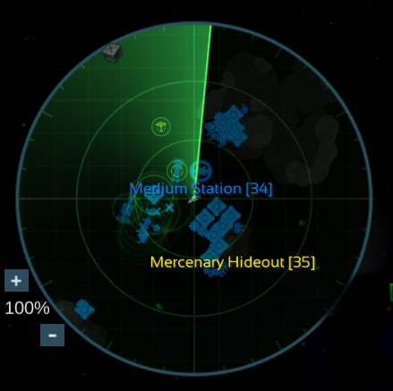

# Radar Scanner — a Star Valor mod

Gives the sector scanner in the bottom left corner of the flight view an old-school radar look:

- **A rotating scan line** sweeps round the scanner, with a green afterglow trailing behind it.
- **Phosphor fade.** Everything on the scanner lights up as the line passes over it, then dims
  until the line comes round again.
- **Ripple blips.** When the line passes a detected ship, station, jumpgate, piece of loot, wreck
  or ordinary asteroid, a ripple spreads out from it and fades. Huge asteroids never ripple.
  Ordinary asteroids get a smaller, fainter ripple so an asteroid field doesn't drown out a ship.
- **A radar screen**: a dark green tint, two range rings, a crosshair and bearing ticks round the
  rim.



The mod only draws over the scanner. The game's own icons, labels, zoom buttons and scanner range
are unchanged, and it detects nothing the game doesn't: a ripple appears only around something
the game already shows on the scanner. It changes nothing in your save.

The mod has no text of its own, so it has no language files.

## Installation

The mod needs **BepInEx 5**, the standard mod loader for Star Valor. If you already use other
Star Valor BepInEx mods, skip to step 2.

### 1. Install BepInEx 5

1. Download **`BepInEx_win_x64_5.4.23.2.zip`** from the
   [BepInEx 5.4.23.2 release](https://github.com/BepInEx/BepInEx/releases/tag/v5.4.23.2).
   Use the **Windows x64** build of **BepInEx 5**, even on Linux. BepInEx 6 will not work.
2. Open the game folder. In Steam: right-click **Star Valor** → **Manage** → **Browse local files**.
3. Extract the zip into that folder. `winhttp.dll`, `doorstop_config.ini` and the `BepInEx` folder
   must end up **next to `Star Valor.exe`**, not in a subfolder.
4. **Linux / Steam Deck (Proton) only:** in Steam, right-click **Star Valor** → **Properties** →
   **General** → **Launch Options**, and enter:
   ```
   WINEDLLOVERRIDES="winhttp=n,b" %command%
   ```
   Without this, Proton ignores BepInEx and no mods load.
5. Start the game once, then quit. BepInEx creates `BepInEx/plugins`, `BepInEx/config` and
   `BepInEx/LogOutput.log`.

### 2. Install Radar Scanner

1. Download **`RadarScanner-<version>.zip`** from the
   [Releases page](https://github.com/cydergoth/radar-scanner/releases/latest).
2. Extract it into the game folder (the same folder as `Star Valor.exe`). This creates
   `BepInEx/plugins/RadarScanner/`, which holds `RadarScanner.dll`.
3. Start the game and fly. The scan line turns on the scanner in the bottom left corner.

### Checking it worked

`BepInEx/LogOutput.log` should contain:

```
[Info   :Radar Scanner] Radar Scanner 1.0.0 loaded
```

If the log file doesn't exist, BepInEx isn't running. Check that the files are next to
`Star Valor.exe`, and on Linux check the launch option. If the log says the mod is not compatible
with this version of the game, a game update changed something the mod relies on. Please
[open an issue](https://github.com/cydergoth/radar-scanner/issues) and attach the log.

### Updating

Download the new release and extract it over the old one, replacing the file in
`BepInEx/plugins/RadarScanner/`.

### Uninstalling

- To remove only this mod, delete `BepInEx/plugins/RadarScanner/`.
- To remove BepInEx too, delete `BepInEx/`, `winhttp.dll`, `doorstop_config.ini` and
  `changelog.txt` from the game folder, and clear the launch option.

The mod saves nothing in your save files, so you can remove it at any time.

## Configuration

`BepInEx/config/starvalor.radarscanner.cfg` is created the first time the game runs with the mod.
Edit it while the game is closed. If you use a mod that edits BepInEx settings in game, such as
Configuration Manager, changes show on the scanner straight away.

**`[General]`**

| Setting | Default | Meaning |
|---|---|---|
| `Enabled` | `true` | Show the radar overlay. Turn off to get the game's plain scanner back |
| `SweepSeconds` | `4` | How long the scan line takes to go all the way round |
| `Clockwise` | `true` | Which way the scan line turns |
| `PhosphorColor` | `40FF66FF` | Colour of the scan line, afterglow, grid and ripples, as `RRGGBBAA` |
| `TrailDegrees` | `120` | How far the afterglow trails behind the scan line |
| `FadeStrength` | `0.55` | How much the scanner dims between passes. `0` is no fading, `1` fades to black |
| `ScreenTint` | `0.3` | Strength of the dark tint over the scanner. `0` is none |
| `ShowGrid` | `true` | Draw the range rings, crosshair and bearing ticks |

**`[Ripples]`**

| Setting | Default | Meaning |
|---|---|---|
| `Ships` | `true` | Ripple around detected ships |
| `Stations` | `true` | Ripple around discovered stations and jumpgates |
| `Loot` | `true` | Ripple around detected loot, wrecks and containers |
| `Asteroids` | `true` | Ripple (smaller and fainter) around detected ordinary asteroids |
| `RippleSeconds` | `1.4` | How long a ripple takes to spread and fade out |
| `RippleSize` | `26` | How wide a ship's ripple gets. The scanner is 256 wide |
| `RelationColors` | `false` | Colour ship and station ripples by their relation to you (hostile, friendly, ...) instead of the phosphor colour |

If the fading makes icons too hard to read at a glance, lower `FadeStrength`. If asteroid fields
are too busy, turn `Asteroids` off.

## Compatibility

- Built against Star Valor Steam build 24937123 (Unity 2019.4.41f1) and BepInEx 5.4.23.2.
- Works alongside [Production Summary](https://github.com/cydergoth/production_summary) and
  [Extended Fleet Commands](https://github.com/cydergoth/extended_fleet_commands).
- Achievements are unaffected. The game has no mod detection, and this mod doesn't touch perks,
  stats or Steam.
- If a game update renames something the mod relies on, the mod disables itself at startup and
  writes the reason to `BepInEx/LogOutput.log`. If the overlay fails while the game is running, it
  switches itself off and the game's own scanner keeps working.

## Building from source

You need the [.NET SDK](https://dotnet.microsoft.com/download) 6 or newer and a Star Valor
install, because the build references the game's own DLLs. Those DLLs are not included in this
repository.

```bash
./install.sh     # build and copy the DLL into the game's BepInEx/plugins folder
./package.sh     # build and create the release zip in dist/
# or build only:
dotnet build -c Release -p:GameDir="/path/to/Star Valor"
```

`GAME_DIR` (for the scripts) and `-p:GameDir` (for `dotnet build`) default to the standard Linux
Steam location. The project file also checks the default Windows Steam path.

### How it works

The game draws the scanner with a second camera that follows the player and renders only the
scanner icons into a texture. That texture is shown in the UI at `Scanner/Images/MaskedImage/Image`,
under a round mask.

**Overlay.** A postfix on `MinimapControl.Start` adds the overlay as a child of that image. Being a
child, it is clipped by the game's round mask, and it appears and disappears with the scanner (in
the sector map, for example). The scanner border, zoom buttons and station labels are separate
objects drawn after it, so they stay on top. The overlay's three textures are drawn in code, so the
mod ships no image files:

- the **screen**: tint, range rings, crosshair and ticks. It doesn't move.
- the **sweep**: the scan line, its afterglow, and a black veil that gets thicker the longer it has
  been since the line passed. Rotating this one image is what makes the game's own icons light up
  under the line and fade behind it.
- the **ring** that every ripple is made of.

**Ripples.** The game turns each object's scanner icon on and off as you detect or lose it, so the
mod treats an active icon as "detected" instead of repeating the game's range rules. Four times a
second it walks the groups the game keeps its ships, stations, loot and asteroids in and lists the
detected ones. Every frame it asks the scanner camera where each one is on the scanner, and when
the scan line crosses an object's bearing it starts a ripple there: two rings, the second just
behind the first, that grow and fade and follow the object. Huge asteroids are a different kind of
object (`BigAsteroidControl`) that the mod never lists.

## AI disclosure

This mod's code and documentation were written with the AI coding assistant
[Claude Code](https://claude.com/claude-code), directed and reviewed by the author. Commits made
with it carry a `Co-Authored-By: Claude` trailer. If you share the mod on sites that label AI
content, such as Nexus Mods, tag it as AI-generated code.

Star Valor is made by Rafael Burgos. This is an unofficial fan mod, and the developer does not
endorse or support it.

## License

[MIT](LICENSE) © 2026 cydergoth. The license covers this mod's source code only. Star Valor and its
assets belong to their developer, and BepInEx has its own license.
